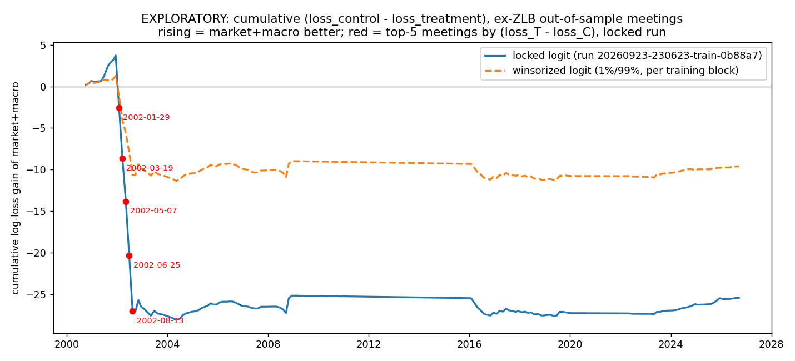

# FedWatch v5 - EXPLORATORY diagnostics (20260924-223122)

**EXPLORATORY. Not pre-registered. Never headline these numbers.** The pre-registered primary result is run `20260923-230623-train-0b88a7` (lock `c8b679059019`), unchanged.

Code: `fomc_explore_v5.py` at git `55156ab`; data: cached only (`data_cache_v5/`, offline); inputs read from `Result_v5/runs/20260923-230623-train-0b88a7/` and `Result_v5/runs/20260923-231425-train-5f7981/` (read-only).

Rules written at 2026-09-25T05:31:22Z (UTC), before any computation.

## Decision rules (fixed before any number below was computed)

**Item 2 - winsorized logit** (difference = winsorized treatment log loss - winsorized control log loss,
ex-ZLB out-of-sample meetings):
- difference <= +0.02 (treatment within 0.02 of control, or better): the "fat tails drove the null"
  story is **SUPPORTED**.
- difference > +0.05 (treatment still worse by more than 0.05): the story is **NOT SUPPORTED**.
- +0.02 < difference <= +0.05: **INCONCLUSIVE** (between the two thresholds; this third branch was
  added when writing the rules down, because the two given rules leave this gap).

**Item 3 - S2 surprises**, judged separately for S2a (anchor 1 day) and S2b (anchor 11 days):
- **ROBUSTLY PREDICTABLE** only if the one-sided Clark-West p < 0.1 in ALL of (b) Covid window
  excluded, (c) winsorized, (d) both.
- Otherwise: **in-sample predictability, out-of-sample fragile**.

Items 0, 1 and 4 are descriptive. Nothing here is a pre-registered result; the locked primary
result (run 20260923-230623-train-0b88a7) stands as reported.

## Item 0 - sanity checks

### 0a. Which infl_mom definition produced the locked run?

```
PREREG_LOCK.json locked_utc : 2026-09-24T06:06:23Z
PREREG_LOCK.json git.commit : d8de7aba8c16bb6c48bc29b2004490c91a72e46e
git log for that commit      : d8de7ab 2026-09-23T23:05:49-07:00 prereg: record pre-registration commit 6c6a937 and tick checklist (calendar final, before any real-data run)
fomc_core_v5.py at d8de7ab (relevant lines):
  697: pce = get("PCEPILFE")
  699: pce_3m, _ = _latest_ok(pce, _ann3)
  704: f["infl_mom"] = pce_3m - TAYLOR["pi_star"]
sha256 of fomc_core_v5.py at d8de7ab  : 58f6e81f7efb2e9f371f45407b1af23ff536a82c45d310df3d52d253aece0b9c
sha256 recorded in locked run manifest   : 58f6e81f7efb2e9f371f45407b1af23ff536a82c45d310df3d52d253aece0b9c
identical                                : True
commits touching fomc_core_v5.py between d8de7ab and the run commit: none
```

**Answer: core PCE 3m annualized - 2  (i.e. "core PCE 3m - 2").**

### 0b. Label timing for the Sep 15-16, 2026 meeting

```
Last 3 target changes in cached DFEDTARU (date: from -> to):
  2025-10-30  4.25 -> 4.00  (-0.25)
  2025-12-11  4.00 -> 3.75  (-0.25)
  2026-09-17  3.75 -> 4.00  (+0.25)

Locked dataset row 2026-09-15: decision_date 2026-09-16, move +0.25, y 2 (Hike)
Label = target(decision + 3d = 2026-09-19) - target(start - 1d = 2026-09-14) = 4.00 - 3.75 = +0.25
Read date 2026-09-19 is AFTER the decision day 2026-09-16: True
```

**Confirmed: the label reads the target 3 days AFTER the decision day (2026-09-19 vs decision 2026-09-16).**

## Item 1 - Loss decomposition of the primary test (locked run, ex-ZLB)

T = logit|market+macro (treatment), C = logit|market (control). Probabilities are [Cut, Hold, Hike]. z_* = (value - mean of that meeting's training block) / sd (ddof=0).

### 15 meetings with the largest (loss_T - loss_C)

```
           actual   T_cut  T_hold  T_hike   C_cut  C_hold  C_hike  loss_T  loss_C  diff_T_minus_C  taylor_gap  infl_mom    sahm  claims_chg_3m  z_taylor_gap  z_infl_mom   z_sahm  z_claims_chg_3m
2002-08-13   Hold  0.8799  0.0005  0.1196  0.0648  0.7980  0.1371  6.9083  0.2256          6.6826     -0.7653   -0.5379  1.3333       -10.0757       -3.2918     -0.7533   9.5669          -1.9604
2002-06-25   Hold  0.8612  0.0007  0.1381  0.0197  0.6675  0.3129  6.9080  0.4043          6.5038     -0.4677   -0.1238  1.4333        -0.3783       -2.7977     -0.1091  10.2976          -0.1468
2002-01-29   Hold  0.8933  0.0001  0.1066  0.1143  0.5534  0.3322  6.9087  0.5916          6.3170     -0.8738   -0.2632  1.6333       -14.3154       -3.4719     -0.3260  11.7589          -2.7533
2002-03-19   Hold  0.2118  0.0006  0.7876  0.0071  0.4302  0.5627  6.9081  0.8436          6.0645     -0.5251   -1.1918  1.5000       -12.7273       -2.8931     -1.7706  10.7847          -2.4563
2002-05-07   Hold  0.7252  0.0032  0.2716  0.0126  0.5697  0.4177  5.7419  0.5627          5.1793     -0.2244   -1.3772  1.3667         8.5923       -2.3938     -2.0589   9.8104           1.5308
2002-12-10   Hold  0.4441  0.2259  0.3299  0.3113  0.4709  0.2178  1.4875  0.7531          0.7344     -1.6975    0.2600  0.5667         0.6353       -3.3960      0.5310   0.9477           0.0311
2016-03-15   Hold  0.0314  0.3762  0.5924  0.0273  0.6808  0.2918  0.9776  0.3845          0.5931     -3.1349   -0.0120 -0.0333         0.3714       -2.5249      0.4316  -0.4378           0.0779
2016-04-26   Hold  0.0415  0.4563  0.5022  0.0437  0.7630  0.1933  0.7846  0.2705          0.5140     -3.0399   -0.0407  0.0000        -4.5905       -2.4523      0.3933  -0.3965          -0.6087
2008-09-16   Hold  0.4499  0.5409  0.0092  0.0871  0.8341  0.0788  0.6145  0.1814          0.4331     -1.6188    0.7884  1.1000        17.6353       -1.9216      1.3047   2.5086           2.8212
2003-03-18   Hold  0.2613  0.5331  0.2056  0.1061  0.8037  0.0902  0.6290  0.2185          0.4105     -1.1374   -1.4954  0.2000         7.1337       -2.6965     -1.6287   0.0821           1.0259
2003-05-06   Hold  0.1817  0.5377  0.2806  0.0580  0.8028  0.1392  0.6205  0.2197          0.4009     -1.0779   -1.2433  0.1333         9.7977       -2.6222     -1.3185  -0.0753           1.4338
2016-07-26   Hold  0.0470  0.5319  0.4212  0.0409  0.7928  0.1663  0.6314  0.2322          0.3992     -2.9524   -0.4062 -0.0333        -2.2642       -2.3855     -0.0953  -0.4378          -0.2868
2016-06-14   Hold  0.0712  0.5374  0.3914  0.0351  0.7720  0.1929  0.6210  0.2588          0.3622     -3.1319   -0.3489 -0.0333         5.9330       -2.5226     -0.0186  -0.4378           0.8474
2003-01-28   Hold  0.1157  0.5752  0.3091  0.0776  0.8065  0.1159  0.5530  0.2151          0.3380     -1.0627   -0.6957  0.3000        -2.7795       -2.6033     -0.6448   0.3182          -0.4917
2003-08-12   Hold  0.1452  0.4797  0.3752  0.1311  0.6715  0.1973  0.7347  0.3982          0.3365     -0.7948   -0.6677  0.4667        -5.6734       -2.2686     -0.6104   0.7116          -0.9347
```

### Concentration

```
ex-ZLB out-of-sample meetings: 136; sum of (loss_T - loss_C) = +25.4397; mean = +0.1871 (locked primary mean diff)
top  5: sum +30.7472 = 120.9% of the total difference; mean diff of the remaining 131 meetings = -0.0405  (descriptive only, not a test)
top 10: sum +33.4323 = 131.4% of the total difference; mean diff of the remaining 126 meetings = -0.0634  (descriptive only, not a test)
```

## Item 2 - Winsorized logit (exploratory robustness of the primary)

Same 26 walk-forward blocks, feature sets, LOGIT_C = 0.3, ex-ZLB sample (n = 136) and DM-HAC test as the locked primary. Only change: every feature clipped at the 1%/99% percentiles of each block's TRAINING rows (same bounds applied to that block's test rows), for control and treatment alike.

```
Replica check (same loop, no clipping) - max |difference| from the locked predictions:
  logit|market+macro: 4.11e-15
  logit|market: 8.26e-14
```

```
                                   locked logit    winsorized logit
log loss treatment (ex-ZLB)             +0.6989             +0.5817
log loss control (ex-ZLB)               +0.5118             +0.5110
mean diff T - C                         +0.1871             +0.0707
t (DM, HAC 4)                           +1.0472             +1.0197
p (two-sided)                           +0.2950             +0.3079
block-bootstrap 90% CI       [-0.0443, +0.5410]  [-0.0256, +0.2086]
all meetings: mean diff                 +0.1823             +0.0554
all meetings: p                         +0.1404             +0.2264
```

**Decision rule: winsorized treatment - control = +0.0707 -> NOT SUPPORTED.**

## Item 3 - S2 surprise robustness

Surprise file: {'file': 'monetary-policy-surprises-data.xlsx', 'sheet': 'FOMC (update 2023)', 'date_col': 'Date', 'value_col': 'MPS', 'n': 360, 'first': '1988-02-04', 'last': '2023-12-13', 'share_not_month_start': 0.958}
Covid window (excluded from training AND forecasting): meetings starting 2020-03-01 to 2021-12-31. Winsorizing: predictors clipped at the 1%/99% percentiles of the expanding training window at each step (past rows only). OOS forecasts start at observation 40 of each sample.

### S2a (anchor 1 day)

```
S2a replica check: R2 -17.184 vs locked -17.184; CW t +2.082 vs locked +2.082; n 199 vs locked 199
```

(a) Top 10 meetings by |cw_t| (cw_t = 2 * y_t * f_t):

```
                 mps  forecast      cw_t
2008-12-15 -0.249541 -0.098342  0.049081
2001-11-06 -0.153178 -0.073018  0.022369
2008-09-16  0.103027 -0.089944 -0.018533
2020-04-28  0.002900 -3.105558 -0.018014
2001-12-11 -0.061781 -0.120519  0.014892
2001-05-15 -0.129298 -0.050677  0.013105
2009-03-17 -0.058125 -0.108574  0.012622
2004-01-27  0.151906  0.037465  0.011382
2022-03-15  0.138073  0.035506  0.009805
2001-06-26  0.086201 -0.054341 -0.009368
```

```
sum(cw_t) over 199 OOS meetings = +0.148924  (max |2yf - trainer cw| = 1.5e-15)
top 3 by |cw_t|: sum +0.052917 = 35.5% of sum(cw_t)
top 10 by |cw_t|: sum +0.087340 = 58.6% of sum(cw_t)
```

### S2b (anchor 11 days)

```
S2b replica check: R2 -19.871 vs locked -19.871; CW t +2.416 vs locked +2.416; n 199 vs locked 199
```

(a) Top 10 meetings by |cw_t| (cw_t = 2 * y_t * f_t):

```
                 mps  forecast      cw_t
2008-12-15 -0.249541 -0.086331  0.043086
2001-11-06 -0.153178 -0.101871  0.031209
2008-09-16  0.103027 -0.102765 -0.021175
2020-04-28  0.002900 -3.339067 -0.019368
2001-05-15 -0.129298 -0.071515  0.018494
2009-03-17 -0.058125 -0.117344  0.013641
2004-01-27  0.151906  0.042780  0.012997
2022-03-15  0.138073  0.046382  0.012808
2008-10-28 -0.046985 -0.100104  0.009407
2002-05-07 -0.036361 -0.124779  0.009074
```

```
sum(cw_t) over 199 OOS meetings = +0.165848  (max |2yf - trainer cw| = 6.6e-16)
top 3 by |cw_t|: sum +0.053120 = 32.0% of sum(cw_t)
top 10 by |cw_t|: sum +0.110173 = 66.4% of sum(cw_t)
```

### Summary (b)-(d)

```
test                         variant  n_oos  R2_vs_zero  CW_t  p_one_sided
 S2a        baseline (full, no clip)    199    -17.1842 2.082       0.0187
 S2a       (b) Covid window excluded    185     -0.0158 2.318       0.0102
 S2a                  (c) winsorized    199     -0.0056 2.515       0.0059
 S2a (d) Covid excluded + winsorized    185     -0.0100 2.294       0.0109
 S2b        baseline (full, no clip)    199    -19.8714 2.416       0.0078
 S2b       (b) Covid window excluded    185     -0.0402 2.705       0.0034
 S2b                  (c) winsorized    199     -0.0286 2.814       0.0024
 S2b (d) Covid excluded + winsorized    185     -0.0216 2.692       0.0036
```

**Decision rule, S2a: ROBUSTLY PREDICTABLE.**
**Decision rule, S2b: ROBUSTLY PREDICTABLE.**

## Item 4 - Figure



File: `Result_v5\explore\20260924-223122\item4_cumulative_loss_gap.png`. Red markers: top-5 meetings from Item 1 (2002-08-13, 2002-06-25, 2002-01-29, 2002-03-19, 2002-05-07).

## Decision-rule outcomes

- Item 2: **NOT SUPPORTED**
- Item 3, S2a: **ROBUSTLY PREDICTABLE**
- Item 3, S2b: **ROBUSTLY PREDICTABLE**

