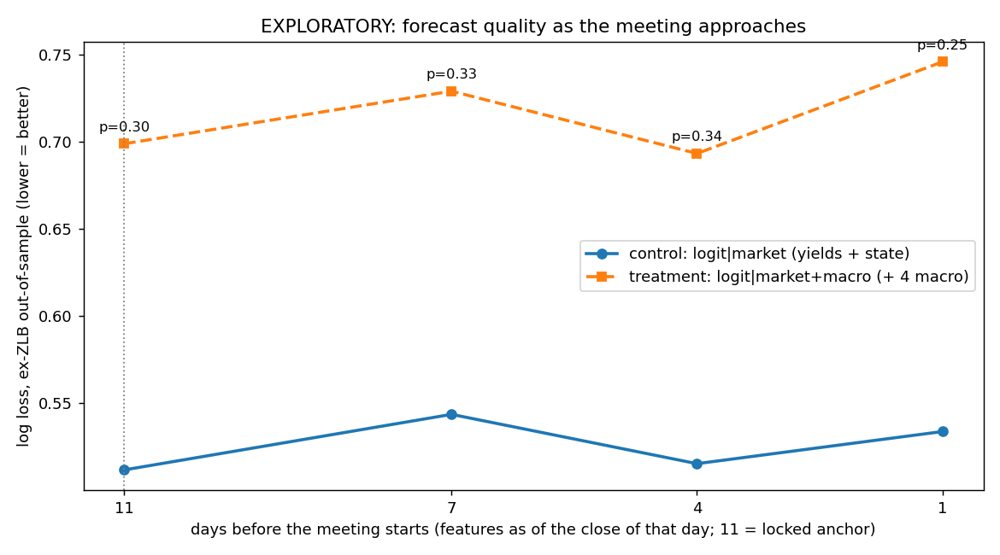

# FedWatch v5 - EXPLORATORY horizon analysis (20260925-204723)

**EXPLORATORY. Not pre-registered (except the 11-day row, which reproduces the locked result).** The pre-registered primary result is run `20260923-230623-train-0b88a7` (lock `c8b679059019`), unchanged.

Code: `code/fomc_explore_v5.py --horizon` at git `7534c4b`; data: cached only (`data/cache_research/`, offline).

Rules written at 2026-09-26T03:47:23Z (UTC), before any computation.

## Decision rules (fixed before any number below was computed)

Each horizon h in [11, 7, 4, 1] (days before the meeting starts) re-runs the locked primary comparison
unchanged except for the anchor: same labels, features, LOGIT_C, walk-forward blocks, ex-ZLB sample,
DM-HAC test and alpha = 0.1. Only h = 11 is pre-registered; the other horizons are exploratory.

1. **Per-horizon verdict:** the pre-registered decision rule applied at each h: p < 0.1 and treatment
   better -> MACRO ADDS INFORMATION; p < 0.1 and treatment worse -> MACRO HURTS OUT OF SAMPLE;
   otherwise NO DETECTABLE DIFFERENCE.
2. **Does the last-week data change the picture?**
   - **YES, macro adds information closer in** ONLY IF the verdict at h = 4 or h = 1 is MACRO ADDS INFORMATION.
   - **YES, macro hurts closer in** if the verdict at h = 4 or h = 1 is MACRO HURTS OUT OF SAMPLE (and neither adds).
   - Otherwise: **NO: no horizon shows a detectable difference in either direction**.
3. Three extra tests at alpha = 0.1 are run, so a false positive somewhere is quite likely by chance;
   a single p just under 0.1 is weak evidence.
4. The market-only (control) log loss by horizon is descriptive: it shows how much the yield curve
   already knows as the meeting approaches.

## Item 5 - Horizon analysis

```
11-day row vs locked primary: log loss T 0.6989 vs 0.6989; C 0.5118 vs 0.5118; p 0.2950 vs 0.2950; n 136 vs 136
common sample (meetings usable at every horizon): 261; locked 11-day dataset: 261
```

### The locked comparison at each horizon (ex-ZLB out-of-sample meetings)

```
 days_before  n_exZLB  moves logloss_control logloss_treatment diff_T_minus_C     t     p boot90_lo boot90_hi acc_control acc_treatment                  verdict
          11      136     63         +0.5118           +0.6989        +0.1871 +1.05 0.295   -0.0443   +0.5410       75.7%         76.5% NO DETECTABLE DIFFERENCE
           7      136     63         +0.5437           +0.7290        +0.1854 +0.97 0.334   -0.0709   +0.5736       74.3%         77.2% NO DETECTABLE DIFFERENCE
           4      136     63         +0.5154           +0.6933        +0.1779 +0.96 0.336   -0.0617   +0.5504       73.5%         77.9% NO DETECTABLE DIFFERENCE
           1      136     63         +0.5338           +0.7459        +0.2120 +1.15 0.248   -0.0349   +0.5751       72.1%         70.6% NO DETECTABLE DIFFERENCE
```

### How much newer macro data each horizon sees (share of meetings with a newer observation than at 11 days)

```
 days_before PCEPILFE CPILFESL UNRATE ICSA
           7       7%       7%     1%   0%
           4      17%      27%    13% 100%
           1      26%      28%    13% 100%
```

### Decision-rule outcomes

- 11 days before: **NO DETECTABLE DIFFERENCE**
- 7 days before: **NO DETECTABLE DIFFERENCE**
- 4 days before: **NO DETECTABLE DIFFERENCE**
- 1 days before: **NO DETECTABLE DIFFERENCE**

**Does the last-week data change the picture? NO: no horizon shows a detectable difference in either direction.**

## Figure



File: `results\explore\20260925-204723-horizon\horizon_logloss.png`.

