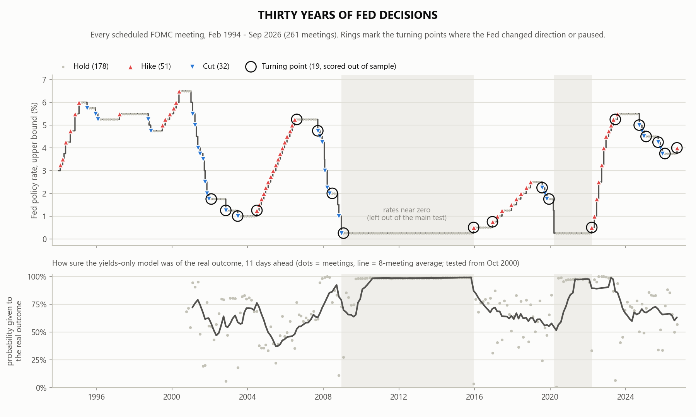
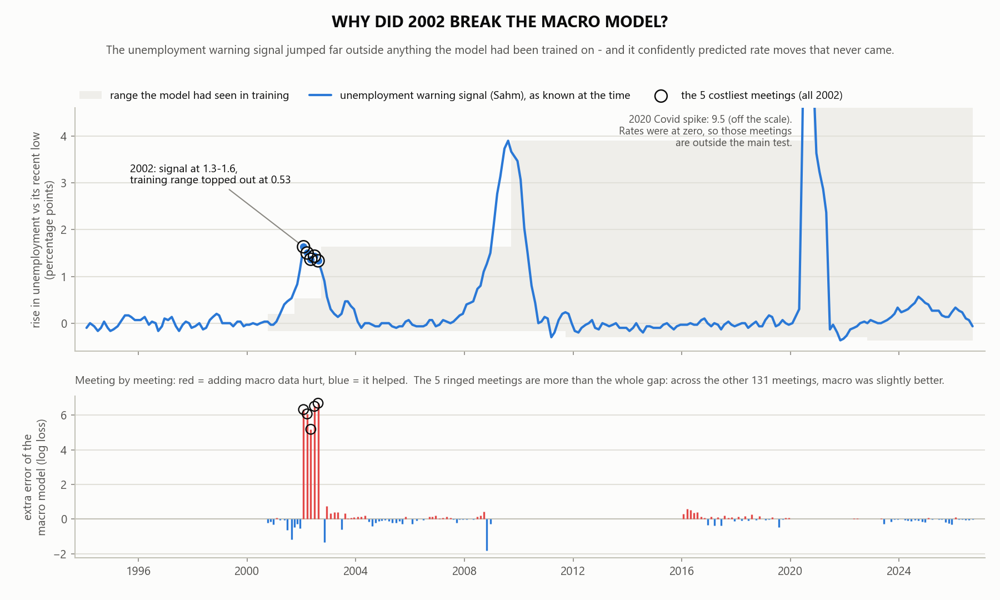
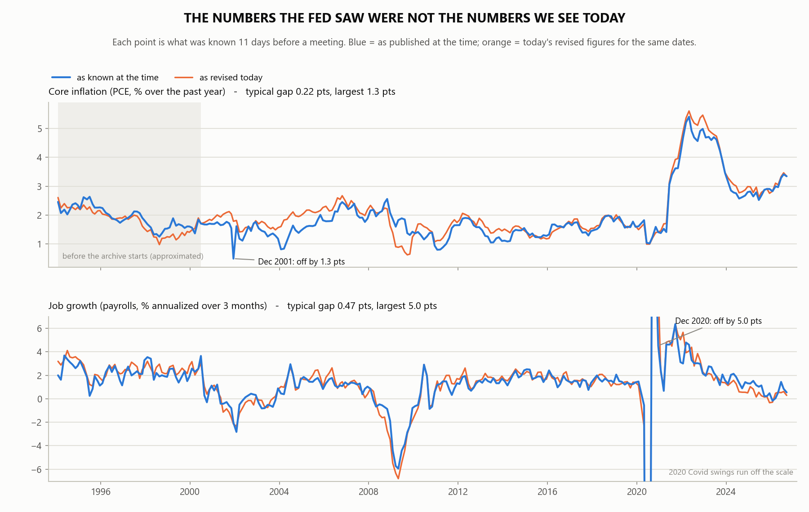
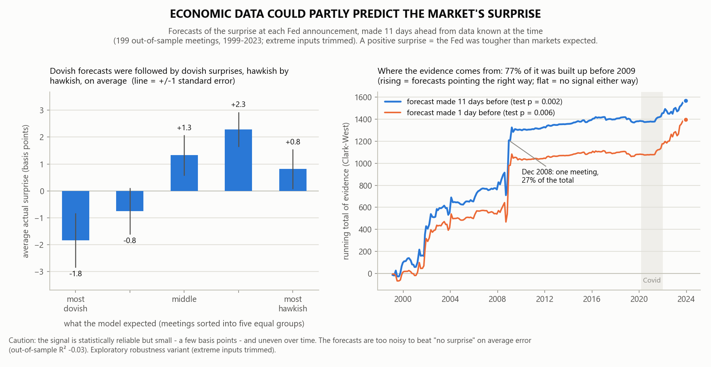

# FedWatch v5 - story figures

*Descriptive figures drawn from the locked run `20260923-230623-train-0b88a7` and the frozen data. They compute no
new test. Made by `code/fomc_figures_v5.py` (git `0962e1f`), 2026-10-11T04:30:48Z.*

## Figure 1 - Thirty years of Fed decisions

Top: the Fed's policy rate with every scheduled meeting marked: 51 hikes, 32 cuts and
178 holds across 261 meetings. Rings mark the 19 turning points scored out of
sample. Grey bands are the years when rates were near zero. Bottom: the probability the yields-only model
gave, 11 days ahead, to what actually happened.

## Figure 2 - Why did 2002 break the macro model?

Top: the unemployment warning signal (Sahm) at each meeting, against the range the model had seen in its
training data. At the five ringed 2002 meetings (2002-08-13, 2002-06-25, 2002-01-29, 2002-03-19, 2002-05-07) the signal read
1.33-1.63; the highest value in training was 0.53. Bottom: the
extra error from adding macro data, meeting by meeting. Those five meetings are more than the whole gap
(121% of it): across the other meetings the average gap is -0.041, meaning macro was
slightly better. The 2020 Covid spike in the signal is noted but not drawn to scale; rates were at zero then,
so those meetings are outside the main test. Descriptive only, not a test.

## Figure 3 - The numbers the Fed saw were not the numbers we see today

What was known 11 days before each meeting, as published at the time (blue) and as the same figures
stand after later revisions (orange). Core PCE inflation: typical gap 0.22
points, largest 1.3 (2001-12-11). Payroll growth: typical gap
0.47 points, largest 5.0
(2020-12-15). This is why the study uses real-time data.

## Figure 4 - Economic data could partly predict the market's surprise

The surprise track (S2), winsorized variant from the exploratory robustness run. Left: 199 out-of-sample
meetings sorted into five equal groups by the surprise the model expected 11 days ahead; bars are the
average actual surprise in each group, in basis points (-1.8, -0.8, +1.3, +2.3, +0.8 from most
dovish to most hawkish). Right: the running total of Clark-West evidence for the 11-day forecasts
(S2b: t = +2.81, one-sided p = 0.002) and the day-before
forecasts (S2a: t = +2.52, p = 0.006). The evidence is uneven
over time: 77% of the 11-day total was built up before 2009, the largest single meeting
(Dec 2008) is 27% of it, and the line is nearly flat from 2009 to 2020. The signal is reliable
but small: out-of-sample R-squared is -0.029 (S2b) and -0.006
(S2a), so the forecasts do not beat "no surprise" on average error, and the correlation between
forecast and actual is +0.25. Exploratory.
